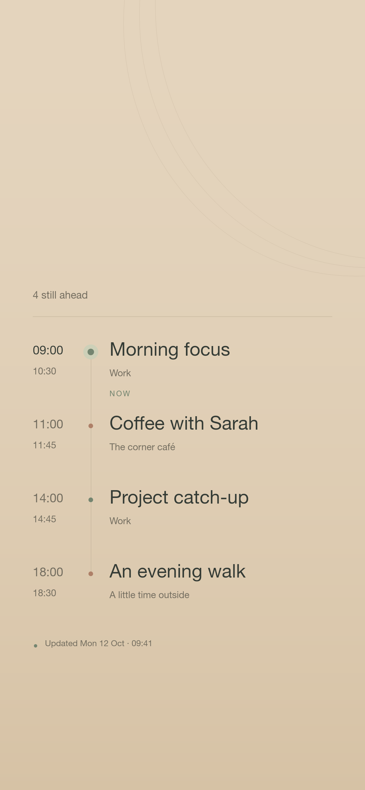

# Calendar Lockscreen

A quiet daily agenda on your iPhone lock screen, with warm parchment during daylight and a dark palette at night.
Google Calendar events appear through Apple Calendar, and the wallpaper refreshes through an iPhone shortcut.

<p align="center">
  
  
</p>

The previews use fictional events.
The blank upper area leaves room for your iPhone's native clock, date, and widgets.

**[Download the script](https://github.com/OuterCFO/calendar-lockscreen/releases/latest/download/Calendar.Wallpaper.js)** · [Latest release](https://github.com/OuterCFO/calendar-lockscreen/releases/latest)

## What it does

- Shows today's ongoing and upcoming events from your chosen calendars.
- Uses your saved location to calculate daylight locally, with no weather service or API key.
- Keeps the update timestamp above the flashlight and camera controls.
- Returns a PNG file directly to Shortcuts, avoiding text and Base64 conversion steps.
- Supports scheduled refreshes at sunrise, sunset, and times you choose.

This is a generated wallpaper, not a live widget.
It changes only when the shortcut runs, after events have synced into Apple Calendar.
The script changes wallpaper colors, not the iPhone's screen-brightness setting.

## Before you start

You need an iPhone, [Scriptable](https://scriptable.app/), Apple's Shortcuts app, and iCloud Drive enabled for Scriptable.
The layout was used on an iPhone 14 running iOS 26.5.
Other screen sizes and lock-screen arrangements may need layout adjustments.

For Google Calendar, add your Google account to Apple Calendar and enable calendar sync.
Follow [Google's iPhone instructions](https://support.google.com/calendar/answer/99358?hl=en&co=GENIE.Platform%3DiOS) if needed.
**Confirm your events appear in Apple's Calendar app before continuing.**
No Google API credentials are required by this script.

## 1. Install the script

1. Download the script above and import it into Scriptable on your iPhone.
   AirDrop from a Mac is one option; if iOS only previews the source, use the share sheet to open it in Scriptable.
   Alternatively, copy the entire [script source](Calendar%20Wallpaper.js), create a new script with **+** in Scriptable, and paste it into the editor.
2. Name the script **Calendar Wallpaper**.
3. Run it once **inside Scriptable**, allowing location access and full calendar access when prompted.
4. Select the calendars you want to show.
5. Confirm that a wallpaper preview appears.

Your approximate location is saved for subsequent background runs.
If you travel, run the script inside Scriptable again to update it.
Daylight follows the saved location until then.

## 2. Build the shortcut

In Shortcuts, create a shortcut named **Refresh Calendar Wallpaper** with these four actions, in this order:

| Action | Configuration |
| --- | --- |
| **Text** | Type `auto` in lowercase. |
| Scriptable **Run Script** | Select **Calendar Wallpaper**. Set **Parameter** to the preceding **Text** variable. Turn **Run In App** and **Show When Run** off. |
| **Get Images from Input** | Set its input to **Output** from **Run Script**. |
| **Set Wallpaper Photo** / **Set Wallpaper** | Use **Images** from the previous action. Choose the wallpaper you want to update and **Lock Screen only**. Turn **Show Preview** and **Crop to Subject** off. |

Action labels can vary by iOS version.
Run the shortcut once and approve any access prompts, then lock your phone to check the result.

### Selecting the parameter

If tapping **Parameter** opens a file picker, long-press the field and choose **Select Variable**, then select the output of the **Text** action.
The Run Script action should read **Run Calendar Wallpaper with Text**.
You do not need to fill in the expanded Texts, URLs, Images, or Files fields.

### Important: keep the output as an image

Use **Get Images from Input**, not **Get Text from Input**.
Converting the returned file to text can show only its filename.
Do not add dictionary extraction or Base64 decoding.
The script returns an actual PNG file through [Scriptable's supported iCloud file output](https://docs.scriptable.app/script/#setshortcutoutput).

## 3. Schedule automatic updates

In **Shortcuts → Automation → + → Time of Day**, create each trigger below.
Choose **Run Immediately** and select **Refresh Calendar Wallpaper** as the shortcut to run.
If your iOS version instead offers **Ask Before Running**, turn it off.

| Trigger | Purpose |
| --- | --- |
| Sunrise, **15 minutes after**, daily | Refresh the agenda and apply the daytime palette. |
| Sunset, **15 minutes after**, daily | Refresh the agenda and apply the nighttime palette. |
| **12:00**, daily | Refresh calendar changes and remove finished events. |
| **16:00**, daily | Refresh again during the afternoon. |
| **00:00**, daily | Start the new day's agenda. |

The offset accommodates small differences between Apple's sunrise/sunset times and the script's solar calculation.
You can add more time-of-day triggers for more frequent updates.
There is no immediate push refresh when you edit a calendar event.
Apple documents [time-of-day and sunrise/sunset triggers](https://support.apple.com/guide/shortcuts/event-triggers-apd932ff833f/ios) and [automatic execution](https://support.apple.com/guide/shortcuts/enable-or-disable-a-personal-automation-apd602971e63/ios).

**Verify on your phone:** add a temporary automation for two minutes from now, lock the phone, and check whether the wallpaper's update time changes.
Delete that temporary automation afterward.
Background execution can depend on device permissions and iOS behavior; desktop tests cannot verify it.

## Troubleshooting

| Symptom | What to check |
| --- | --- |
| Blank output, a filename, or “Please provide an image” | Preview **Output** directly from Run Script using Quick Look. Remove text conversion, dictionary lookup, and Base64 actions. Then connect Get Images directly to Run Script Output. |
| Events are missing or old | Check the same events in Apple Calendar first. Run the shortcut again after sync. Only selected calendars and events that have not ended are shown. |
| Calendar or location permission error | Open the script in Scriptable and run it directly. Review Scriptable's permissions in iPhone Settings. |
| Wrong theme after travel | Run the script inside Scriptable again to save your current location. Keep the shortcut parameter set to `auto`. |
| Updated code does not appear on the phone | Reimport the downloaded script or transfer it with AirDrop. Confirm Run Script points to the newly imported script, especially if Scriptable added a number to its name. |
| Clock, widgets, or controls overlap the agenda | Disable Crop to Subject and adjust the layout constants below for your device. Notifications may still cover wallpaper content. |
| More than eight events remain | The script stops with an error and leaves the existing wallpaper in place. It does not silently drop events. |

To reselect calendars, temporarily change the script's `selectedCalendars(parameter === "setup")` call to `selectedCalendars(true)`, run it inside Scriptable, then restore the original line.

## Customize

Edit `SETTINGS`, `LIGHT_THEME`, and `DARK_THEME` near the top of the script.

- `width` and `height`: output dimensions, defaulting to 1170 × 2532.
- `agendaTop` and `agendaBottom`: vertical layout in logical points on a 390-point-wide reference canvas.
- `showLocations`: show an event's location when present; otherwise show its calendar name.
- `LIGHT_THEME` and `DARK_THEME`: background, text, and accent colors.

The layout is designed for three or four events, with compact rows up to eight.
Times use 24-hour notation; long titles and locations are truncated to fit.
Changing dimensions alone may not adapt the layout to a different aspect ratio.
Parameters `day` and `night` force a palette for previewing; use `auto` for normal operation.

## Privacy

Calendar events are read through Apple's local calendar database.
The script does not create, modify, or delete events.
Selected calendar identifiers and the saved approximate location are stored in Scriptable's local documents directory.
The PNG is saved as `calendar-wallpaper.png` in Scriptable's iCloud Drive folder and may sync through your Apple account.
Event text is visible on the lock screen, including when the device is locked.
There is no project server, analytics, or external weather request.

## Development

Node.js 22 or newer is required only for development, not for installing the script on your phone.

```sh
npm ci
npm test
npm run previews
```

Tests execute the distributed script through a desktop adapter for Scriptable APIs.
They cover seasonal daylight, polar day/night, saved-location handling, repeated event reads, PNG output, and failure handling.
They do not emulate iOS, Google synchronization, lock-screen cropping, or background Shortcuts execution.
The sample image text uses desktop fonts and can differ slightly from iPhone typography.
GitHub Actions runs the tests on pushes and pull requests.

## License

Project code is available under the [MIT license](LICENSE).
The bundled sun-only subset of [SunCalc 1.9.0](https://github.com/mourner/suncalc/tree/v1.9.0) by Vladimir Agafonkin uses the BSD 2-Clause license, retained inside the script and in [THIRD_PARTY_NOTICES.md](THIRD_PARTY_NOTICES.md).
