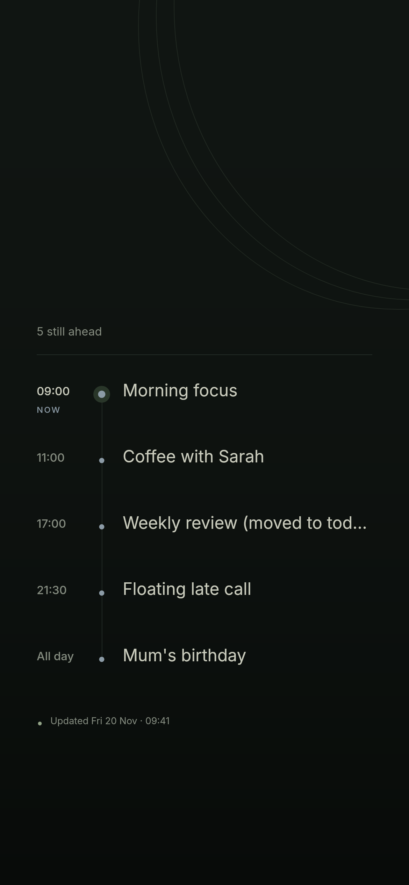

# Calendar Lockscreen

A quiet daily agenda on your iPhone lock screen, with warm parchment during daylight and a dark palette at night.

<p align="center">
  
  
</p>

The previews use fictional events.
The blank upper area leaves room for your iPhone's native clock, date, and widgets.

## How it works

A small server function reads your calendars' private iCal links and draws the wallpaper as a PNG.
On the iPhone, a two-action shortcut downloads that PNG and sets it as the lock-screen wallpaper.

```
Google Calendar ──iCal──▶ /api/wallpaper (Vercel) ──PNG──▶ Shortcuts: Get Contents of URL → Set Wallpaper
```

The phone does no rendering and needs no third-party app.
Version 1 drew the image on the phone with Scriptable, which iOS often stopped when it ran in the background.
That version is still available at the [v1.0.0 tag](https://github.com/OuterCFO/calendar-lockscreen/tree/v1.0.0).

The wallpaper is still a snapshot.
It changes each time the shortcut runs, not the moment you edit an event.

## 1. Get your calendars' private iCal links

In Google Calendar on a computer, open **Settings**, choose a calendar under **Settings for my calendars**, and copy **Secret address in iCal format**.
Repeat for each calendar you want on the wallpaper.
Anyone with one of these links can read that calendar, so treat it like a password.

## 2. Deploy the server

1. Sign in at [vercel.com](https://vercel.com) with GitHub. The free Hobby plan is enough.
2. **Add New → Project**, import this repository, and keep the default settings.
3. Before deploying, add these environment variables:

| Name | Value |
| --- | --- |
| `ICS_URLS` | The secret iCal links, separated by spaces. |
| `WALLPAPER_KEY` | A random string of at least 16 characters, for example from `openssl rand -hex 24`. |
| `TIME_ZONE` | Your IANA time zone, for example `Europe/Paris`. |
| `LATITUDE`, `LONGITUDE` | Your approximate location in decimal degrees, used for sunrise and sunset. |
| `SELF_EMAILS` | Optional. Your calendar email addresses; invitations you declined are hidden. |

4. Deploy, then open `https://<your-project>.vercel.app/api/wallpaper?key=<WALLPAPER_KEY>` in a browser.
   You should see today's wallpaper.
   Add `&mode=day` or `&mode=night` to preview a palette.

## 3. Build the shortcut

In Shortcuts, create a shortcut named **Refresh Calendar Wallpaper** with two actions:

| Action | Configuration |
| --- | --- |
| **Get Contents of URL** | The URL from step 2, including `?key=`. |
| **Set Wallpaper Photo** | Use **Contents of URL**. Choose the wallpaper to update and **Lock Screen** only. Turn **Show Preview** and **Crop to Subject** off. |

Run it once and lock the phone to check the result.
If the server cannot read a calendar, it returns an error instead of an image, and the previous wallpaper stays.

## 4. Schedule updates

In **Shortcuts → Automation → + → Time of Day**, create triggers that run **Refresh Calendar Wallpaper** with **Run Immediately**.
A good start: 15 minutes after sunrise, 15 minutes after sunset, 00:05, 12:00, and 16:00.
Each run is cheap, so you can add more times, such as every hour you are awake.
The 15-minute offset avoids small differences between Apple's sunrise time and the server's calculation.

To check background runs, add a temporary automation two minutes from now, lock the phone, and check that the **Updated** time on the wallpaper changes.

## Troubleshooting

| Symptom | What to check |
| --- | --- |
| Set Wallpaper says there is no image | Open the shortcut's URL in a browser. The error message names the problem: wrong key (401), server setup (500), or a calendar link that failed (502). |
| Events are missing or old | Check that the calendar's secret link is in `ICS_URLS`. Google can take a few minutes to update its iCal feed after an edit. |
| Wrong times | Check `TIME_ZONE`. When travelling, update it in Vercel and redeploy. |
| Wrong palette | Check `LATITUDE` and `LONGITUDE`. |
| The agenda overlaps the clock or controls | Turn off Crop to Subject and keep the clock at its normal size. Adjust `LAYOUT` in `lib/render.js` for other screen sizes. |

More than eight remaining events show the first seven and a "+ N more today" line.

## Customize

Edit `LAYOUT`, `LIGHT_THEME`, and `DARK_THEME` in `lib/render.js`, then push; Vercel redeploys automatically.
The layout targets a 1170 × 2532 screen (iPhone 12 to 14) on a 390-point-wide reference grid.

## Privacy

Your calendar events pass through your own Vercel deployment each time the wallpaper is built.
Nothing is stored there; the image is generated per request and sent with `Cache-Control: no-store`.
The iCal links and key live only in Vercel's environment variables, never in the repository.
Event text is visible on the lock screen, including when the phone is locked.

## Development

Node.js 22 or newer is required.

```sh
npm ci
npm test
npm run preview
```

The tests cover time zones and daylight saving, recurring events with moved, deleted, and cancelled occurrences, all-day and floating events, declined invitations, palette choice, PNG output, overflow, and HTTP failures.
`npm run preview` regenerates `assets/day.png` and `assets/night.png` from `tests/fixtures/sample.ics`.

## License

Project code is available under the [MIT license](LICENSE).
Bundled fonts are under the SIL Open Font License; see [THIRD_PARTY_NOTICES.md](THIRD_PARTY_NOTICES.md).
